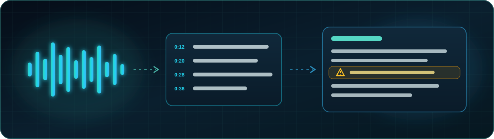
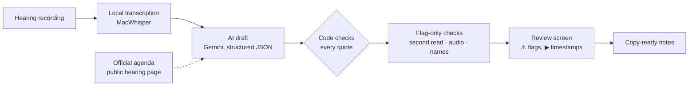
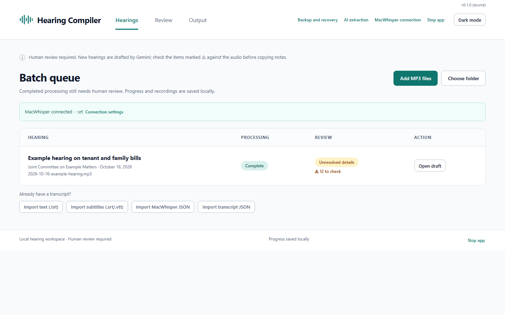
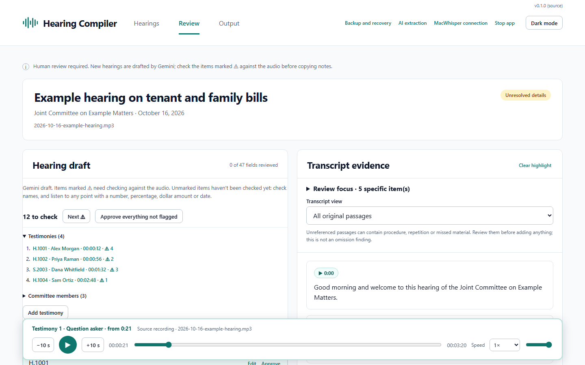
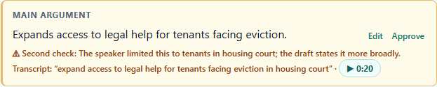
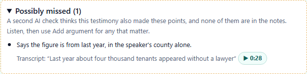
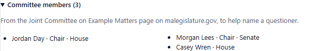
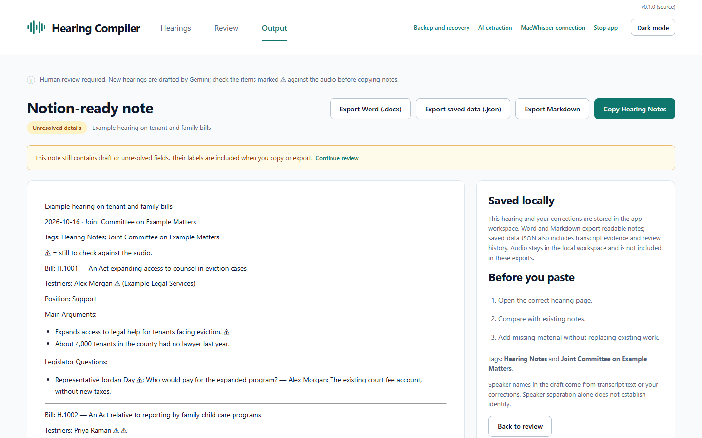

<p align="center"></p>

<div align="center">

# Hearing Compiler

</div>

A Mac app that turns multi-hour public hearings into reviewable, source-linked notes, so the person
reviewing them only has to listen where it matters.

<p align="center">
  <a href="#the-problem"></a>
  <a href="docs/EVALUATION.md"></a>
  <a href="docs/ARCHITECTURE.md"></a>
  <a href="hearing_compiler/"></a>
  <a href="#run-it-locally"></a>
</p>

[**Case study**](#the-problem) · [**Evaluation**](docs/EVALUATION.md) · [**Architecture**](docs/ARCHITECTURE.md) · [**Decisions**](docs/DECISIONS.md) · [**Code**](hearing_compiler/)

> **This is a portfolio case study.** The app is in real use by one legislative staff member. This
> repository is a cleaned copy of its code: real hearings, reviews and people are replaced by synthetic
> examples, and internal project records are left out. Screenshots use a synthetic hearing.

## How it fits together

<div align="center">



</div>

The AI writes a draft; it never has the last word. Code locates every quote in the transcript, extra checks
can only **add** ⚠ flags, and a person approves each item before it reaches the notes.

## The problem

A staff member takes structured notes on public committee hearings: who testified, on which bill,
for or against, their main arguments, and the legislators' questions and answers. Hearings run two to
four hours, often with dozens of testimonies, and there's a year-long backlog.

Listening to everything is slow. Trusting an AI summary blindly is worse: a wrong name, bill or position
in the notes is a real mistake. The goal was to **cut listening time without lowering trust in the notes.**

## What I did

I led the project end to end, building it with AI coding agents under my direction:

- **Product:** worked out the requirements with the user, kept the scope small, and set the rule that
  AI produces drafts, never final notes.
- **Evaluation:** tested on real public hearings, measured where the AI was wrong, and set
  recall-first quality targets (see [Evaluation](docs/EVALUATION.md)).
- **Engineering direction:** made the architecture and trade-off calls, and had an independent AI
  reviewer audit every feature before release. Each review found real defects, all fixed first.
- **Delivery:** signed Mac releases with self-update, rolled out to a real user, and changed course
  from her feedback.

## How it works

| | |
|---|---|
|  | **Batch queue.** Add MP3s or a folder. Each hearing is transcribed locally, drafted, and checked. Failures are isolated, and Retry never repeats finished work. |
|  | **Review.** Items the AI wasn't sure of are marked ⚠. *Next ⚠* jumps between them, ▶ plays the recording at each item's moment, and *Approve everything not flagged* finishes the rest. |
|  | **A flag-only second check.** A second AI pass compares each item with the transcript and flags overstatement, quoting what was actually said. Code drops any finding whose quote isn't in the transcript. |
|  | **Possibly missed.** Points the draft may have left out are listed beside their testimony, never added to the notes automatically. |
|  | **Committee members.** From the Legislature's public pages, to help name a questioner. A legislator's name not on the member list is flagged with the closest spelling. |
|  | **Output.** Notes in the destination's format, with anything unresolved still marked ⚠. Existing notes are never overwritten. |

## Results

Measured on real public hearings. Full methods and limits are in [the evaluation](docs/EVALUATION.md).

| What | Result |
|---|---|
| Quotes located in the transcript by code | **95.9–98.9%** across three runs of a 4-hour hearing |
| Unflagged fields with a real error (2.5-hour hearing, all 284 checked) | **6 (about 2%)**, none in names, bills or positions |
| Known errors caught by the flag-only second check | **11 of 13**, every cited quote verified |
| Audio check on a 2-hour hearing | 58 items heard, **1 flag, and it was a true error** (two figures merged) |
| Long-hearing drafting after the cut-point fix | **3 calls instead of 4, 370 s instead of 807 s**, cuts on the chair's hand-offs |
| Gemini run-to-run variation | 79 / 68 / 73 testimonies on one transcript; skipped testimony is now redrafted or warned |
| Review time reported by the user | about **20 minutes** for a 2-hour hearing |

The headline isn't any single number. It's that every number came from **real hearings**, and each
gap the numbers showed became a fix, a flag or a new check.

## Engineering practice

- **Tests:** 305 unit tests in this copy, plus a 51-step browser check run in WebKit and Chromium against a
  synthetic hearing with a fake model. No test needs a key or spends money.
- **CI and releases:** every change is built and checked on macOS runners, signed with a pinned identity,
  and published as a pre-release. A person promotes a build to the installed app, which updates itself
  and rolls back if the new build doesn't start.
- **Reviews:** an independent AI reviewer audits each feature before release: cancellation that didn't
  stop paid calls, duplicate testimony, an off-by-range clamp, silent failures, a false sync in a parser.
- **Privacy and cost:** transcription stays on the Mac. API keys live in the macOS Keychain. Every AI
  reply is saved, so a retry or rebuild never pays twice.

## Key decisions

- **The AI only flags; people decide.** No check can change a value or approve an item.
- **Code owns citations.** The model must quote the transcript verbatim; code finds the quote and keeps
  the timestamp. A quote that can't be found is flagged.
- **Recall before precision.** Zero unflagged errors in names, bills and positions comes first. Fewer
  false ⚠ comes second, and an automatic "this is fine" only after it proves itself in shadow mode.
- **Long hearings are cut where the chair moves on,** never at an arbitrary pause.

More, with the trade-offs: [Decisions](docs/DECISIONS.md).

## Find what you need

### Read the evaluation

What was measured, how, the numbers, and what they don't prove.

[Open the evaluation](docs/EVALUATION.md).

### See the architecture

The pipeline, storage and recovery, long-hearing parts, the checks, and the release and update path.

[Open the architecture](docs/ARCHITECTURE.md).

### Browse the code

- [`hearing_compiler/`](hearing_compiler/): the app. Start with [`extraction.py`](hearing_compiler/extraction.py)
  (drafting), [`second_check.py`](hearing_compiler/second_check.py), [`audio_check.py`](hearing_compiler/audio_check.py),
  [`parts.py`](hearing_compiler/parts.py) (long hearings) and [`roster.py`](hearing_compiler/roster.py).
- [`web/`](web/): the review screen, in plain JavaScript.
- [`tests/`](tests/): the unit tests, with synthetic fixtures.
- [`scripts/friday_check.py`](scripts/friday_check.py): the end-to-end browser check.

### Run it locally

Python 3.13. From the repository root:

```
python -m venv .venv
.venv/Scripts/python -m pip install -r requirements-dev.txt   # macOS: .venv/bin/python
.venv/Scripts/python -m unittest discover -s tests
.venv/Scripts/python launch_prototype.py
```

The app starts empty. Import a transcript (TXT, SRT or VTT) to try the review screen. AI drafting needs
your own Gemini key, and transcription needs MacWhisper on a Mac.

## Status and limits

- In real use by one person since October 2026, on public hearings only.
- The evaluation covers a handful of hearings and one reviewer; it's evidence, not a benchmark.
- Built as a focused tool for one workflow, not a general product.

## License

Copyright © 2026 mewzicians. All rights reserved. This repository is published for viewing as a portfolio
piece; see [LICENSE](LICENSE).
